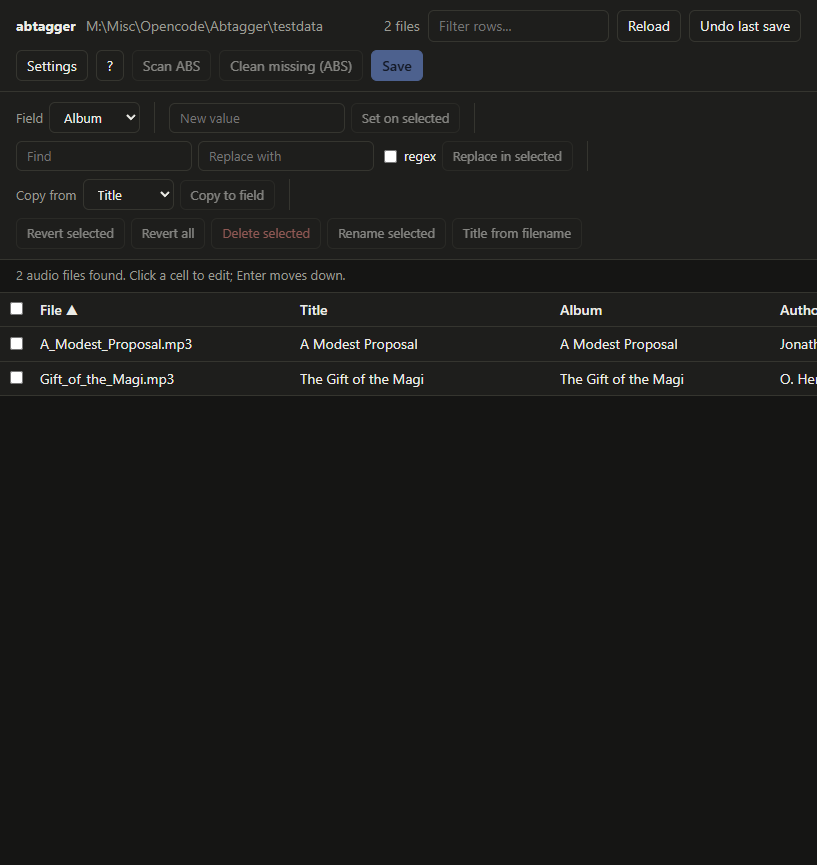

# abtagger

[](https://github.com/happyfunpaul/Abtagger/actions/workflows/tests.yml)

A small, local, spreadsheet-style editor for **audiobook** metadata. Point it at a
folder and it scans recursively for `.m4b` / `.m4a` / `.mp3` files, shows one row
per book (expandable to the individual files) in an editable grid, and writes the
tags **into the audio files themselves**. Nothing is renamed or moved unless you
ask.



Built because Audiobookshelf (ABS) keeps metadata in sidecar files and never
touches the audio. abtagger's philosophy is the opposite: the audio files are the
source of truth, so a book is a standalone, portable unit you can copy to a USB
drive and hand to someone.

```
pip install mutagen
python abtagger.py /path/to/audiobooks
```

Then open the URL it prints (it contains a random access token).

## Features

- Spreadsheet-style grid: book title and subtitle, per-file track titles, author, narrator, series, series #, year, genre.
- Bulk operations: set a field on selected rows, find/replace (literal or regex),
  copy one field into another, revert selected/all.
- Per-file and bulk editing, with validation and dirty-cell highlighting.
- Book-level grouping view: one row per book, even for a multi-file audiobook.
  A file-count badge marks multi-file books; book-row edits apply to every file,
  and fields whose files differ show `— mixed —`. Expand the row to edit the
  individual files (for example, per-chapter titles).
- Optimistic concurrency: refuses to overwrite a file that changed on disk since load.
- Undo the last save (value-based).
- Rename/move files to a configurable template (with conditional folders).
- De-duplication detection (exact normalized title/author/series/duration).
- Delete selected files.
- Optional Audiobookshelf integration: trigger a library scan / clean missing items.
- Cover art, chapters, and any tag the grid doesn't show are left untouched.

## Tag mapping

Chosen to match what Audiobookshelf reads. ABS maps the **album** tag (falling
back to **title**) to its **Title**, the **subtitle** tag to its **Subtitle**,
and the **title** tag to per-file track/chapter titles. The grid follows that
model:

| grid field  | M4B / M4A                              | MP3 (ID3v2)            |
|-------------|----------------------------------------|------------------------|
| title       | `@sti` → `©alb` → `©nam`; writes `©alb` (+ `@sti` if present) | `TALB` → `TIT2`; writes `TALB` |
| subtitle    | `©st3` → iTunes `SUBTITLE` → Tone `SUBTITLE`; writes the standard tag and updates existing freeform tags | `TIT3` → `TXXX:SUBTITLE`; writes both |
| track title | `©nam`                                 | `TIT2`                 |
| author      | `©ART` (+ `aART` if empty/equal)       | `TPE1`                 |
| narrator    | `©wrt` (composer)                      | `TCOM`                 |
| series      | iTunes `SERIES` + `©mvn`               | `TXXX:SERIES` + `MVNM` |
| series_num  | iTunes `SERIES-PART` (+ `©mvi` if int) | `TXXX:SERIES-PART` + `MVIN` |
| year        | `©day`                                 | `TDRC`                 |
| genre       | `©gen`                                 | `TCON`                 |

The underlying tag key is still `album` (for ABS compatibility), but it is
labelled **Title** in the UI. For a single-file book, Title and Track title are
often the same value; for a multi-file book, Title is the book title and Track
title is the per-file/chapter title.

Audible/Libation M4Bs often store the display title in a custom `@sti` atom
and the subtitle in `----:com.pilabor.tone:SUBTITLE` instead of the standard
atoms. Abtagger reads those as fallbacks, so the grid shows the same Title and
Subtitle values that ABS shows for those files. Writes update the standard
atoms and any existing Audible/Tone atoms.

There is one **Title** column. In Book view it shows the book title; when a
multi-file book is expanded, its child rows show each file's track title in that
same column. File view shows track titles for every file. This keeps the
book-level view free of a field that ABS does not expose as book metadata.

## Safety

- Binds to `127.0.0.1` by default; requires a random token on every API call.
- Refuses paths outside the folder you pointed it at (path traversal protection).
- Checks that a file has not changed on disk since it was loaded before writing.
- Keeps an undo log of every save in `~/.abtagger`.
- `--read-only` mode for browsing only.

## CLI

```
python abtagger.py ROOT [options]

  --host HOST          listen address (default 127.0.0.1)
  --port PORT          (default 8765)
  --token TOKEN        use this access token instead of a random one
  --state-dir DIR      where undo logs live (default ~/.abtagger)
  --read-only          browse only
  --open               open the page in your browser
  --abs-url URL        Audiobookshelf base URL
  --abs-token TOKEN    ABS API token
  --abs-library ID     ABS library id to scan (auto-detected if omitted)
```

## Rename template language

Rename selected files with a template. Placeholders: `{title}` (book title;
`{album}` is an alias), `{subtitle}`, `{track_title}` (per-file title), `{author}`,
`{author_first}`, `{author_last}`, `{narrator}`, `{series}`, `{series_num}`, `{year}`,
`{genre}`, `{filename}`, `{stem}`, `{ext}`.

Wrap optional parts in `[ ]`: a bracket is emitted only if every placeholder inside
it is non-empty. Example:

```
{author_last}, {author_first}/[{series}/][{series_num} - ]{title}
```

- A standalone book (no series) becomes `James, Aaron/Assholes.m4b`.
- A series book becomes `James, Aaron/Stormlight Archive/1 - The Way of Kings.m4b`.
- Add a trailing `/{title}` to get one folder per book.

Use `/` to create folders. Illegal filename characters are sanitized. The template is
saved in Settings so you are not prompted every time (Shift+click "Rename selected"
overrides for a one-off).

## Audiobookshelf integration

Optional. Configure via Settings or CLI/env. Then use:
- **Scan ABS** — trigger a library scan for this folder.
- **Clean missing (ABS)** — remove ABS items flagged missing for this folder.

Rename/move auto-triggers an ABS scan. Tag saves do not (manual, per your preference).

## Settings

Stored in `~/.abtagger/config.json` (ABS URL/token/library, rename template).

## Development

```
python -m unittest discover -s tests
```

40 tests covering validation, path safety, tag round-trips, rename templates,
de-duplication, and book grouping.

## Roadmap

- Rename preview table (instead of a confirm dialog).
- Duplicate view with color-coded groups.
- Metadata fetch with preview/diff.
- M4B combining (via `ffmpeg`/`m4b-tool`, not a custom muxer).
- ABS metadata push (not just scan).

## License

MIT. See `LICENSE`.